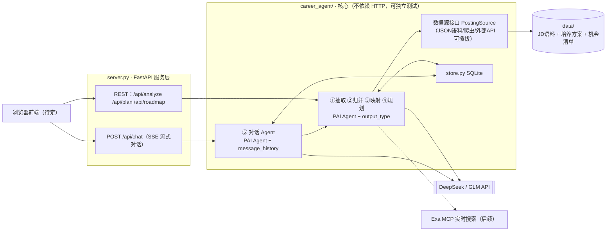

# 02 · 架构设计

## 技术栈（已定，变更需走 ADR）

| 层 | 选型 | 说明 |
|---|---|---|
| Web 服务 | FastAPI + uvicorn | REST + SSE 流式；自动 /docs 接口文档 |
| Agent 框架 | PydanticAI v2 | typed 工具与输出、校验自动重试；DeepSeek/智谱/Kimi 原生 provider |
| 大模型 | DeepSeek 或 智谱 GLM（.env 一处切换） | 非推理档做主链路；演示前禁换模型禁升版本 |
| 存储 | SQLite（标准库 sqlite3） | 学生档案 / 历史方案 / LLM 结果缓存 |
| 数据处理 | pandas | 频次统计等确定性计算，绝不交给 LLM |
| 前端 | 待定（简版网页，路线图 M5 决策） | 候选：手写 HTML+JS；PydanticAI 的 Vercel AI/AG-UI 适配器 |

## 分层架构

数据流导读：数据源层把任何来源的岗位信息统一成 `list[JobPosting]`；①→④是纯函数流水线，上一步的 Pydantic 输出就是下一步的输入；⑤对话 Agent 通过工具调用驱动同一套流水线，感知画像变化后重规划；一切 LLM 结果落 SQLite 缓存；FastAPI 只做协议转换，不含业务逻辑。

## 模块职责

| 文件 | 职责 | 禁止做的事 |
|---|---|---|
| `career_agent/schemas.py` | 全项目数据契约（Pydantic 模型） | 禁止放业务逻辑 |
| `career_agent/datasource.py` | PostingSource 接口 + 语料/爬虫/API 三实现 | 禁止做任何 LLM 调用 |
| `career_agent/llm.py` | 模型工厂：provider/模型名一处配置 | 禁止在其他文件直接 new 模型 |
| `career_agent/pipeline.py` | ①~④流水线，每函数一个 PAI Agent | 禁止做确定性统计（那是 pandas 的事） |
| `career_agent/agent.py` | ⑤对话 Agent（工具注册 + 历史管理） | 禁止绕过流水线直连模型 |
| `career_agent/store.py` | SQLite：档案/方案/缓存读写 | 禁止存明文 API key |
| `career_agent/config.py` | .env 读取与全局配置 | —— |
| `server.py` | FastAPI 路由与 SSE | 禁止写业务逻辑 |

## 数据契约（摘要，权威定义在 schemas.py）

`JobPosting`（数据源产出）→ `ExtractedRequirements`（①出）→ `SkillStat[]`（②出，含频次/是否核心）→ `CourseMapping[]`（③出）→ `Roadmap`（④出，按学期）；`StudentProfile` 是 ③④⑤ 的共同输入。改契约 = 改 schemas.py + 组内通知 + 更新本文档。

## 关键设计决策

1. **公共底座与框架解耦**：数据源/契约/存储/统计不依赖 PydanticAI，换框架只动 llm.py/pipeline.py/agent.py（约 1 天）。
2. **LLM 只做语义判断，pandas 做确定性计算**——结果稳定性的第一保障。
3. **一切 LLM 调用走缓存**（store.py，按输入哈希），演示可断网回放。
4. **多 Agent 规模受控**：主 Agent + 2~3 专家并行 + 1 轮 review + 汇总；辩论 ≤ 2 轮；评审用低价快模型。
5. **temperature=0** 全局纪律（pipeline 内）。

> 本文由架构 Owner 维护；结构性改动（加/删模块、改分层）必须先写 ADR。
