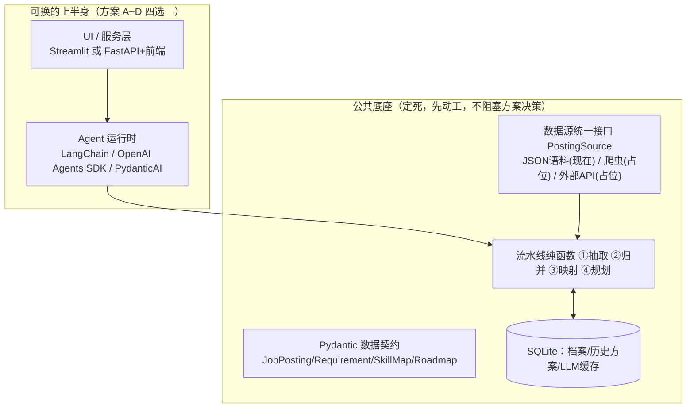

# 职规 Agent · 技术选型方案 v3（多方案对比版）

> 结构：**公共底座定死（与框架无关，可先动工）+ 上半身四选一（小组决策）**。
> 框架选择的 stakes 因此被大幅降低：数据源、流水线、数据契约、存储都不随框架变，后悔成本 ≈ 重写一个 `agent.py` 和 UI 层（1~2 天）。

---

## 一、公共底座（无论选哪套方案都完全相同）



- `core/datasource.py`：`PostingSource` 接口，换数据源只改一行（爬虫方案保留为占位实现）
- `core/pipeline.py` + `core/schemas.py`：四个纯函数，JSON 进 JSON 出，页面直调和 Agent 工具调共用同一份代码
- `data/`：JD 语料 50~100 条 + 培养方案 + 竞赛/实习清单（人工整理，唯一的重活）
- 模型：任一 OpenAI 兼容国产 API（DeepSeek / 智谱 GLM / Qwen），开发用免费/低价档，演示用标准模型

## 二、2026 主流 Agent 框架格局（调研结论）

| 框架 | 定位 | 国内模型支持 | 中文资料 | 一句话结论 |
|---|---|---|---|---|
| LangChain / LangGraph | 最大生态（1000+ 集成），v1.0 后 API 稳定 | 好 | 最多 | 教程最多的"标准答案"，但抽象层厚、调试体验差（基准评测 DX 5/10） |
| OpenAI Agents SDK | 官方定位"最小 API 面"，handoff/guardrails/sessions/tracing 内置 | **官方内置支持任意 OpenAI 兼容端点**（DeepSeek/GLM/Qwen 均可，三行配置，不需要 OpenAI 账号） | 渐多，官方文档优秀 | 最薄、最贴模型，业界新项目采用率最高的轻量选择 |
| PydanticAI | "FastAPI 感觉的 GenAI 框架"，类型安全 | 好（20+ 提供商） | 少 | 代码量最少、开发体验最好（DX 8/10），生态比 LangChain 小一个数量级 |
| CrewAI | 角色团队式多 Agent | 好 | 多 | 我们是单 Agent+固定流水线，用它等于拿协作框架干单人活 |
| AutoGen | 会话式多 Agent | 好 | 多 | **2025-10 起维护模式**，官方已转向 Microsoft Agent Framework，新项目别上 |
| Claude Agent SDK | Claude Code 的 harness（bash/文件工具） | ◐ 锁 Anthropic **协议**而非模型：智谱 GLM/Kimi 官方兼容端点可用 | 渐多（国内多配套 GLM 接入教程） | 见下方说明：可用，但不对口 |
| Google ADK | GCP/Gemini 生态 | 绑 Gemini，大陆访问受限 | 少 | 成熟度问题多，排除 |
| Dify | 可视化平台（工作流+知识库+自带UI） | 好 | 多 | 零代码最快，但结构化流水线/统计页面做不动，技术分打折 |

### 明确排除的及理由

- **Claude Agent SDK**（2026-10 修正评估）：开源（MIT）、国内可安装；**锁的是 Anthropic 协议而非模型**——智谱 GLM、Kimi 官方提供 Anthropic 兼容端点（`ANTHROPIC_BASE_URL` 即可接入，官方文档：docs.bigmodel.cn），且 SDK 已内置结构化输出（schema 校验 + 自动重试，2026-01 API 侧 GA）。**不再"不可用"，改判"可用但不对口"，维持第四选择**：①它与 Claude Code 同源，定位是"编码/计算机操作 harness"（bash/文件/沙箱为中心），我们的业务工具 + 结构化流水线用不上这些重型能力，还得管权限配置；②底层是 Node 引擎子进程（Python 包内嵌 CLI），比纯 pip 框架重；③走 GLM 兼容端点时，结构化输出等新特性是否被兼容层完整实现**需实测**。若课题是"会写代码/操作电脑的 Agent"，它是第一选择。
- **Google ADK**：绑 GCP/Gemini，大陆访问受限，且早期成熟度问题多。
- **CrewAI / AutoGen**：多 Agent 协作框架，与"单 Agent + 四步固定流水线"的需求形状不匹配；AutoGen 已进维护模式。

## 三、四套候选方案

### 方案 A：Streamlit + LangChain —— "教程最多的大生态"

- 组成：`streamlit` + `langchain`(v1.0 `create_agent`) + `langchain-openai`
- 优势：中文教程海量，组员互助排错最容易；以后加 RAG/知识库有现成组件；答辩老师认知度最高
- 劣势：抽象层厚，报错藏在三层框架里（基准评测开发体验 5/10，全类别最低）；新旧版本教程混杂，**必须锁死版本号**
- 工作量：★★☆（对话层 1~2 天）
- 适合：组员自学全靠中文教程、想要最"标准答案"的写法

### 方案 B：FastAPI + OpenAI Agents SDK + 轻前端 —— "业界最主流的正统组合" ⭐推荐

- 组成：`fastapi` + `openai-agents` + 前端二选一
  - **B1**：简版网页（React/HTML），最正统，工作量最大
  - **B2**：**Streamlit 只当前端壳**，通过 HTTP 调 FastAPI——保留"前后端分离"的架构叙事，前端成本最低（推荐起步用 B2，时间富余再升级 B1）
- 后端形态：`/chat` SSE 流式对话 + `/analyze` `/plan` 等 REST 接口；Agent 用 `Agent` + `@function_tool` + `output_type`(Pydantic) + `SQLiteSession`(会话持久化，与我们 SQLite 选型天然对齐)
- 优势：
  - SDK 是全场最薄的官方框架，工具循环/结构化输出/会话全部内置，几乎没有第三方胶水
  - 前后端分离 = 报告含金量最高、简历上写得出口（这正是你观察到"用得最多"的那套）
  - FastAPI 自动生成 `/docs` 交互式接口文档，演示和答辩直接展示接口全貌
  - 官方文档有流式与 FastAPI 集成示例可抄，不用从零造 SSE
- 劣势：比 Streamlit 单体多一层（要懂一点 HTTP/异步；SSE 转发约百行）；本地要起两个进程；**tracing 默认上传 OpenAI，必须显式关闭**（否则报错/隐私双坑）
- 国产模型接入（官方支持，三行）：
  ```python
  client = AsyncOpenAI(api_key="...", base_url="https://api.deepseek.com/v1")  # 或智谱/Qwen
  set_default_openai_client(client, use_for_tracing=False)
  set_tracing_disabled(True)   # 无 OpenAI key 时必关
  # Agent 里用 OpenAIChatCompletionsModel(model="deepseek-chat", openai_client=client)
  ```
- 工作量：★★★（B2 约 2~3 天）
- 适合：想要业界主流技术栈、组里有人愿意管前后端联调

### 方案 C：Streamlit + PydanticAI —— "最轻最现代"

- 组成：`streamlit` + `pydantic-ai`
- 优势：代码量全场最少（学术评测中逻辑代码量最低档）、类型安全（Pydantic 直接校验 LLM 输入输出——我们的四个结构化函数正是它的舒适区）、开发体验基准评测最高（8/10）、依赖最少；与 FastAPI 同生态，以后想升级成方案 B 的后端无痛
- 劣势：中文教程少，出问题要啃英文官方文档；生态小，没有 LangChain 那种现成集成大杂烩
- 工作量：★☆☆（对话层约 1 天）
- 适合：组员 Python 基本功可以、愿意看英文文档、想要最干净的代码

### 方案 D：Dify 平台 —— "零代码保底"

- 优势：1~2 天出可演示 demo（自带聊天 UI、工作流编排、知识库）
- 劣势：需 Docker 部署；技能频次统计、能力-课程对照表、结构化路线图渲染这类逻辑在画布里做不动，最终还是要外挂代码；"技术设计与实现"25 分的观感打折；迭代靠拖拽，无版本管理
- 工作量：★☆☆ 但功能上限低
- 适合：时间崩盘时的保底，或先用它验证 prompt 思路再落码

## 四、对比矩阵

| 维度 | A LangChain | B FastAPI+OAI SDK | C PydanticAI | D Dify |
|---|---|---|---|---|
| 开发速度 | 中 | 中偏慢 | 快 | 最快 |
| 代码量 / 调试难度 | 多 / 难 | 中 / 易（层薄） | 最少 / 易 | 无代码 |
| 中文资料 | 最多 | 渐多+官方文档优 | 少 | 多 |
| 演示效果 | 流式 OK | **最好**（前后端分离 + /docs） | 流式 OK | 自带 UI |
| 扩展性（加模块/换模型/加RAG） | 生态最大 | 加前端/换模型不动内核 | 换模型一行 | 画布内受限 |
| 报告/简历含金量 | 高 | **最高** | 中上 | 低 |
| 主要风险 | 版本 churn、调试深 | SSE 联调、tracing 坑 | 英文文档 | 功能上限 |

**推荐排序：B(B2) ≥ C > A > D。** 决策指引：组里有人能扛前后端联调 → B；全是 Python 人、求稳求快 → C；自学全靠中文教程 → A；时间不够 → D。

## 五、里程碑（底座先行，方案决策不阻塞动工）

- D1：公共底座动工——datasource 接口 + 跑通"一条 JD → 结构化 JSON"
- D2~3：JD 语料 + 两份知识 JSON；岗位分析页（此时已可给老师/组内看中间成果）
- D4~5：映射 + 路线图 + SQLite；能力地图页、成长路线页
- D6~7：所选方案的对话层 + 就业→考研切换演示脚本
- 剩余：2~3 轮组内测试迭代（**留痕**：输入→问题→改了什么）+ 彩排 + 录备份视频

## 六、演示保底

LLM 结果全缓存进 SQLite（断网可演）；temperature=0 + Pydantic 校验 + 自动重试；另录完整流程视频。

## 附：主要调研来源

- OpenAI Agents SDK 非 OpenAI 模型官方支持：https://openai.github.io/openai-agents-python/models/ ；DeepSeek/Qwen 实测：https://github.com/openai/openai-agents-python/issues/122 ；流式：https://openai.github.io/openai-agents-python/streaming
- Anthropic 对华限售公告（2025-09）：https://www.anthropic.com/news/updating-restrictions-of-sales-to-unsupported-regions ；Claude Agent SDK 定位：https://code.claude.com/docs/en/agent-sdk/quickstart
- 框架横评：https://www.speakeasy.com/blog/ai-agent-framework-comparison/ ；https://www.ai-crescent.com/comparisons/langgraph-vs-crewai-vs-autogen-vs-openai-agents-sdk ；PydanticAI 官方对比：https://pydantic.dev/docs/ai/comparisons/vs-langchain-langgraph/
